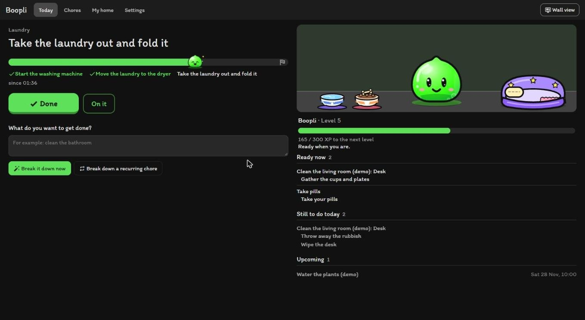

# Boopli

An ADHD-friendly chore and task companion that lives inside [Home Assistant](https://www.home-assistant.io/).

Boopli turns chores into small steps, nudges you with the lights, speakers and phone you already have, and rewards progress with a pet. Everything runs inside your own Home Assistant: no account, no cloud, no server.

> **Status: early development.** Boopli is not ready for daily use yet.

## Install

1. Add `https://github.com/sandschi/Boopli` to HACS as a custom repository of type **Integration** (the first button above), download Boopli, and restart Home Assistant.
2. Add the **Boopli** integration under **Settings, Devices & services** (the second button above).
3. Open **Boopli** in the sidebar. A setup wizard guides you through the rest.

## Documentation

Everything else is in the documentation: **https://sandschi.github.io/Boopli/**

- [Install](https://sandschi.github.io/Boopli/install/) and [Set up Boopli](https://sandschi.github.io/Boopli/setup/)
- [Chores and schedules](https://sandschi.github.io/Boopli/chores/), [AI help](https://sandschi.github.io/Boopli/ai-help/), [Nudges](https://sandschi.github.io/Boopli/nudges/)
- [Wall board](https://sandschi.github.io/Boopli/wall-board/), [Your data and backups](https://sandschi.github.io/Boopli/data-and-backups/), [Development](https://sandschi.github.io/Boopli/development/)

## License

[MIT](LICENSE)

The font Itim is included in the integration (`custom_components/boopli/frontend/fonts`) under the SIL Open Font License 1.1, see `OFL.txt` next to it.
